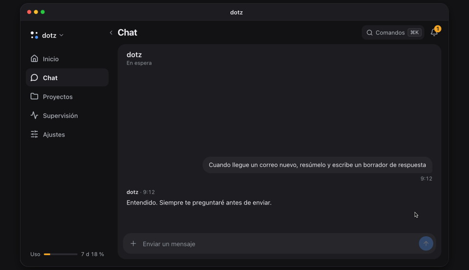

<p align="center">
  <a href="https://ddotz.dev/es/"></a>
</p>

<h1 align="center">dotz</h1>

<p align="center">
  Un asistente personal que se queda encendido en tu propio ordenador.<br>
  Lee el correo nuevo, deja escrito un borrador de respuesta y espera a que pulses enviar desde el móvil.
</p>

<p align="center">
  <a href="README.md">English</a> · <a href="README.ko.md">한국어</a> · <a href="README.ja.md">日本語</a> · <a href="README.zh-CN.md">简体中文</a> · <b>Español</b>
</p>

<p align="center">
  <a href="https://ddotz.dev/es/">Web</a> · <a href="https://ddotz.dev/demo/">Demo</a> · <a href="docs/reference.md">Documentación (en inglés)</a>
</p>

<p align="center">
  
  
</p>

<p align="center">
  <a href="https://ddotz.dev/demo/">
    
  </a>
</p>

## Qué lo hace distinto

- **Funciona en tu ordenador.** Usa las sesiones iniciadas y los archivos que ya tienes. Los secretos se guardan en `~/.dotz/secrets`.
- **Nada sale sin tu permiso.** Cada correo, respuesta o publicación espera en el chat hasta que lo apruebas.
- **Le escribes desde el móvil.** Por la app web, Discord, Telegram o JANDI. En Slack recibes avisos y respuestas.
- **Cada proyecto tiene su propia sesión.** Si un reinicio o un corte de red detiene una tarea, la retoma solo.
- **Encuentra conversaciones antiguas.** Puedes preguntar por "aquello de la semana pasada". El índice y la búsqueda se hacen solo en este ordenador.

## Instalación

```sh
curl -fsSL https://raw.githubusercontent.com/ddotz/dotz/main/install.sh | sh
```

En macOS y Linux, ejecútalo en una terminal. En Windows, dentro de WSL 2 ([guía, en coreano](docs/windows.md)).

Se abre el navegador para la configuración: eliges el nombre del asistente, su tono y qué conectar. dotz ejecuta sus agentes sobre [OmO](https://www.npmjs.com/package/omo-ai), así que inicias sesión con tu proveedor de modelos ahí. Después, escribe `dotz` en una terminal para abrir la app web. Las actualizaciones llegan solas desde este repositorio.

La configuración está en inglés y coreano, y el asistente responde en el idioma que elijas. Por ahora, las pantallas de la app web están en coreano.

## Documentación

- [Referencia](docs/reference.md): opciones de instalación, comandos, pantallas, integraciones, API
- [Arquitectura](docs/ARCHITECTURE.md)
- [Personalización](docs/customization.md)
- [Desarrollo](docs/development.md)
- [Avisos de terceros](THIRD_PARTY_NOTICES.md)
