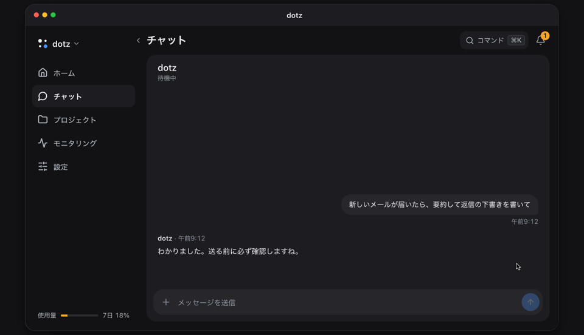

<p align="center">
  <a href="https://ddotz.dev/ja/"></a>
</p>

<h1 align="center">dotz</h1>

<p align="center">
  自分のパソコンで動き続けるパーソナルアシスタント。<br>
  新着メールを読んで返信の下書きを用意し、スマホから送信を押すまで待ちます。
</p>

<p align="center">
  <a href="README.md">English</a> · <a href="README.ko.md">한국어</a> · <b>日本語</b> · <a href="README.zh-CN.md">简体中文</a> · <a href="README.es.md">Español</a>
</p>

<p align="center">
  <a href="https://ddotz.dev/ja/">サイト</a> · <a href="https://ddotz.dev/demo/">デモ</a> · <a href="docs/reference.md">ドキュメント（英語）</a>
</p>

<p align="center">
  
  
</p>

<p align="center">
  <a href="https://ddotz.dev/demo/">
    
  </a>
</p>

## 特徴

- **自分のパソコンで動きます。** パソコンにあるログイン情報やファイルをそのまま使い、秘密の値は `~/.dotz/secrets` に置きます。
- **承認しないと外に出ません。** メール、返信、投稿はチャットで承認するまで送られません。
- **スマホから話しかけられます。** Web アプリ、Discord、Telegram、JANDI で会話でき、Slack では通知と返事を受け取れます。
- **プロジェクトごとにセッションが分かれます。** 再起動や回線の切断で止まった作業は自動で再開します。
- **過去の会話を探せます。** 「先週のあれ」のような聞き方で大丈夫です。索引づくりと検索はこのパソコンの中だけで行います。

## インストール

```sh
curl -fsSL https://raw.githubusercontent.com/ddotz/dotz/main/install.sh | sh
```

macOS と Linux ではターミナルで、Windows では WSL 2 の中で実行します（[Windows の手順、韓国語](docs/windows.md)）。

ブラウザが開くので、アシスタントの名前、話し方、つなぐサービスを順に選びます。エージェントは [OmO](https://www.npmjs.com/package/omo-ai) の上で動くため、モデルのアカウントには OmO でログインします。セットアップ後はターミナルで `dotz` と打つと Web アプリが開きます。アップデートはこのリポジトリから自動で届きます。

セットアップ画面は英語と韓国語で、アシスタントは設定した言語で返事をします。Web アプリの画面は今のところ韓国語です。

## ドキュメント

- [リファレンス](docs/reference.md)：インストールオプション、コマンド、画面、連携、API
- [アーキテクチャ](docs/ARCHITECTURE.md)
- [カスタマイズ](docs/customization.md)
- [開発ガイド](docs/development.md)
- [サードパーティーの表示](THIRD_PARTY_NOTICES.md)
