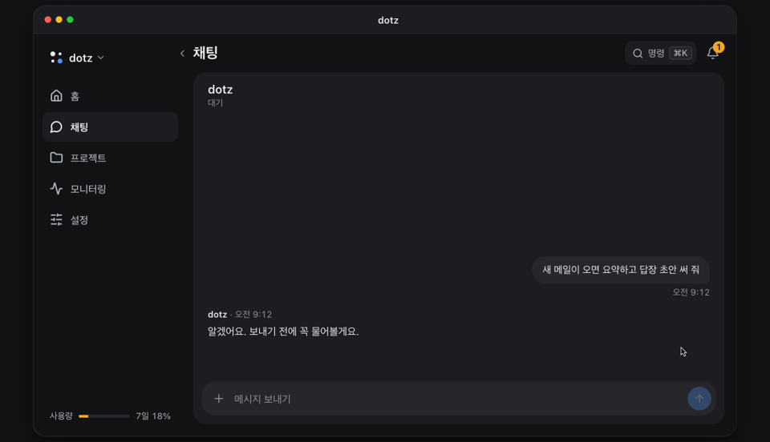

<p align="center">
  <a href="https://ddotz.dev/ko/"></a>
</p>

<h1 align="center">dotz</h1>

<p align="center">
  내 컴퓨터에서 항상 켜져 있는 개인 비서.<br>
  새 메일을 읽고 답장 초안을 써 둔 뒤, 폰에서 내가 보내기를 누를 때까지 기다려요.
</p>

<p align="center">
  <a href="README.md">English</a> · <b>한국어</b> · <a href="README.ja.md">日本語</a> · <a href="README.zh-CN.md">简体中文</a> · <a href="README.es.md">Español</a>
</p>

<p align="center">
  <a href="https://ddotz.dev/ko/">웹사이트</a> · <a href="https://ddotz.dev/demo/">데모</a> · <a href="docs/reference.md">문서</a>
</p>

<p align="center">
  
  
</p>

<p align="center">
  <a href="https://ddotz.dev/demo/">
    
  </a>
</p>

## 다른 점

- **내 컴퓨터에서 돌아요.** 이 컴퓨터에 있는 로그인과 파일을 그대로 쓰고, 비밀값은 `~/.dotz/secrets`에 둬요.
- **내가 허락해야 밖으로 나가요.** 메일, 답장, 게시글은 채팅에서 승인할 때까지 기다려요.
- **폰에서 말을 걸어요.** 웹 앱, Discord, Telegram, JANDI로 대화하고, Slack으로는 알림과 답을 받아요.
- **프로젝트마다 세션이 따로예요.** 재시작이나 네트워크 끊김으로 멈춘 일은 알아서 다시 이어가요.
- **지난 대화를 찾아 줘요.** "지난주에 그거"처럼 막연하게 물어도 돼요. 색인과 검색은 이 컴퓨터 안에서만 돌아요.

## 설치

```sh
curl -fsSL https://raw.githubusercontent.com/ddotz/dotz/main/install.sh | sh
```

맥과 리눅스는 터미널에서, 윈도우는 WSL 2 안에서 실행해요([윈도우 설치 가이드](docs/windows.md)).

브라우저가 열리면 이름과 말투, 연결할 것을 차례로 정해요. 에이전트는 [OmO](https://www.npmjs.com/package/omo-ai) 위에서 돌아서, 모델 계정 로그인은 OmO에서 해요. 설치가 끝나면 터미널에 `dotz`만 쳐도 웹 앱이 열리고, 업데이트는 이 저장소에서 알아서 받아요.

## 문서

- [전체 레퍼런스](docs/reference.md): 설치 옵션, 명령어, 화면, 연동, API
- [밖에서 웹 앱 열기](docs/web-access.ko.md)
- [메신저 연결](docs/messengers/README.ko.md)
- [맥락 검색](docs/context-search.md)
- [내 설정으로 바꾸기](docs/customization.md)
- [구조](docs/ARCHITECTURE.md) · [개발 가이드](docs/development.md) · [서드파티 고지](THIRD_PARTY_NOTICES.md)
