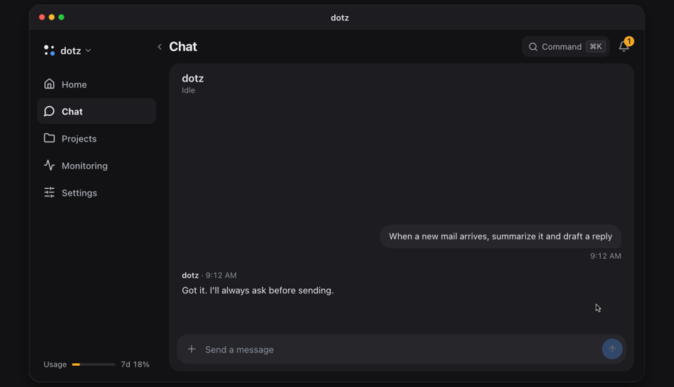

<p align="center">
  <a href="https://ddotz.dev"></a>
</p>

<h1 align="center">dotz</h1>

<p align="center">
  A personal assistant that stays on, on your own computer.<br>
  It reads new mail, drafts the reply, and waits for you to press send from your phone.
</p>

<p align="center">
  <b>English</b> · <a href="README.ko.md">한국어</a> · <a href="README.ja.md">日本語</a> · <a href="README.zh-CN.md">简体中文</a> · <a href="README.es.md">Español</a>
</p>

<p align="center">
  <a href="https://ddotz.dev">Website</a> · <a href="https://ddotz.dev/demo/">Live demo</a> · <a href="docs/reference.md">Docs</a>
</p>

<p align="center">
  
  
</p>

<p align="center">
  <a href="https://ddotz.dev/demo/">
    
  </a>
</p>

## Why dotz

- **It runs on your machine.** It uses the logins and files already on your computer. Secrets stay in `~/.dotz/secrets`.
- **Nothing goes out without your OK.** Every mail, reply or post waits in the chat until you approve it.
- **You reach it from your phone.** Use the web app, Discord, Telegram or JANDI. Slack receives notices and answers.
- **Each project gets its own session.** Work stopped by a restart or a dropped connection starts again by itself.
- **It finds past conversations.** Ask for "that thing from last week". Indexing and search run on this computer only.

## Install

```sh
curl -fsSL https://raw.githubusercontent.com/ddotz/dotz/main/install.sh | sh
```

Run it in a terminal on macOS or Linux. On Windows, run it inside WSL 2 ([guide, in Korean](docs/windows.md)).

A browser opens for setup, where you pick the assistant's name, its tone and what to connect. dotz runs its agents on [OmO](https://www.npmjs.com/package/omo-ai), so you sign in to a model provider there. After setup, type `dotz` in a terminal to open the web app. Updates come from this repo on their own.

The setup screens are in English and Korean, and the assistant replies in the language you set. The web app screens are in Korean for now.

## Docs

- [Reference](docs/reference.md): install options, commands, screens, integrations, API
- [Architecture](docs/ARCHITECTURE.md)
- [Customization](docs/customization.md)
- [Development](docs/development.md)
- [Third-party notices](THIRD_PARTY_NOTICES.md)
