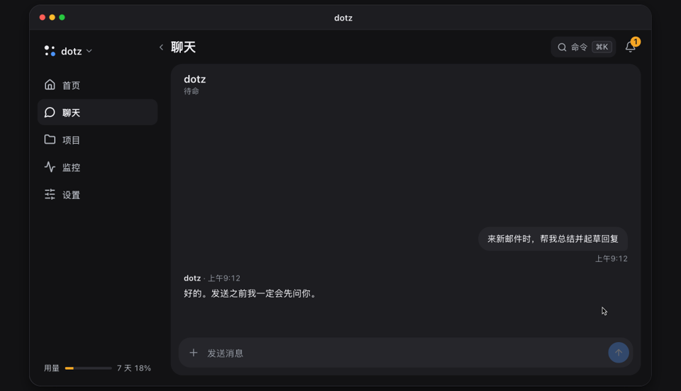

<p align="center">
  <a href="https://ddotz.dev/zh-cn/"></a>
</p>

<h1 align="center">dotz</h1>

<p align="center">
  在你自己的电脑上一直运行的个人助理。<br>
  它读新邮件、写好回复草稿，然后等你在手机上点发送。
</p>

<p align="center">
  <a href="README.md">English</a> · <a href="README.ko.md">한국어</a> · <a href="README.ja.md">日本語</a> · <b>简体中文</b> · <a href="README.es.md">Español</a>
</p>

<p align="center">
  <a href="https://ddotz.dev/zh-cn/">网站</a> · <a href="https://ddotz.dev/demo/">演示</a> · <a href="docs/reference.md">文档（英文）</a>
</p>

<p align="center">
  
  
</p>

<p align="center">
  <a href="https://ddotz.dev/demo/">
    
  </a>
</p>

## 有什么不同

- **在你的电脑上运行。** 直接使用这台电脑上已有的登录状态和文件，密钥保存在 `~/.dotz/secrets`。
- **不经你同意，什么都不会发出去。** 邮件、回复和帖子都会留在聊天里，等你批准。
- **用手机就能找它。** 可以通过网页应用、Discord、Telegram 或 JANDI 对话，Slack 用来接收通知和回复。
- **每个项目有自己的会话。** 因重启或断网中断的工作会自动接着做完。
- **能找回以前的对话。** 像“上周那个”这样随口一问也行。建索引和搜索都只在这台电脑上进行。

## 安装

```sh
curl -fsSL https://raw.githubusercontent.com/ddotz/dotz/main/install.sh | sh
```

在 macOS 和 Linux 上直接在终端运行，Windows 上在 WSL 2 里运行（[Windows 安装说明，韩文](docs/windows.md)）。

浏览器会打开设置页面，依次选择助理的名字、说话方式和要连接的服务。dotz 的代理运行在 [OmO](https://www.npmjs.com/package/omo-ai) 上，模型账号在 OmO 里登录。设置完成后，在终端输入 `dotz` 就能打开网页应用。更新会自动从这个仓库获取。

设置页面有英文和韩文，助理会用你设定的语言回复。网页应用的界面目前是韩文。

## 文档

- [参考手册](docs/reference.md)：安装选项、命令、界面、集成、API
- [架构](docs/ARCHITECTURE.md)
- [自定义](docs/customization.md)
- [开发指南](docs/development.md)
- [第三方声明](THIRD_PARTY_NOTICES.md)
